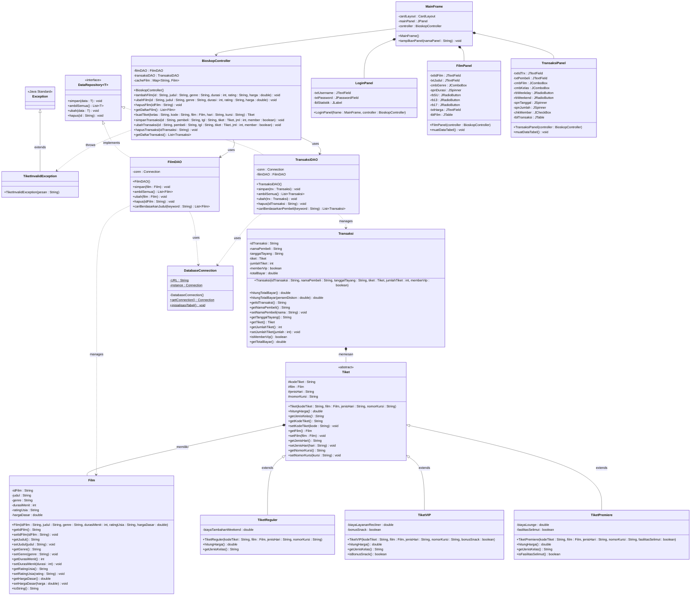

# DOKUMEN SPESIFIKASI KEBUTUHAN PRODUK & DESAIN TEKNIS (PRD)
## Aplikasi Desktop Penjualan Tiket Bioskop — **CineTix**

---

## BAB 1: IDENTITAS & RINGKASAN PROYEK

### 1.1 Tabel Spesifikasi Umum
| Aspek Proyek | Spesifikasi Proyek |
| :--- | :--- |
| **Nama Aplikasi** | **CineTix** — Sistem Informasi Penjualan Tiket Bioskop |
| **Tema Proyek** | Penjualan Tiket Bioskop (Kelompok 7) |
| **Bentuk & Platform** | Aplikasi Desktop berbasis GUI (*Graphical User Interface*) |
| **Bahasa & Framework** | Java (Java Swing) menggunakan JDK $17+$ |
| **IDE Pengembangan** | Eclipse IDE for Java Developers |
| **Pola Arsitektur** | MVC (*Model-View-Controller*) + *Data Access Object* (DAO) |
| **Penyimpanan Data** | Basis Data Relasional Lokal **SQLite** via JDBC (`cinetix.db`) |
| **Tim Pengembang** | $3$ Mahasiswa per kelompok menggunakan Git (*Version Control*) |
| **Durasi Pengerjaan** | $4$ Minggu pelaksanaan dengan $4$ titik pemeriksaan (*milestone*) |

### 1.2 Tujuan Proyek
Setelah membangun aplikasi **CineTix**, tim pengembang mampu:
1. Merancang struktur kelas (*Class Diagram*) yang menerapkan enkapsulasi, pewarisan, polimorfisme, dan abstraksi secara nyata.
2. Mengimplementasikan antarmuka grafis interaktif menggunakan komponen Java Swing, *layout manager*, dan *event handling*.
3. Memisahkan logika bisnis dari tampilan menggunakan pola arsitektur MVC (*Model-View-Controller*).
4. Menghubungkan aplikasi dengan penyimpanan permanen SQLite menggunakan JDBC serta menangani kesalahan menggunakan *exception handling*.
5. Berkolaborasi dalam tim menggunakan Git dengan pembagian *commit* yang merata per anggota.

---

## BAB 2: PEMENUHAN KRITERIA KONSEP OOP (MODEL & LOGIKA)

Aplikasi menerapkan keempat pilar Pemrograman Berorientasi Objek dengan **12 kelas model/logika/data** di luar kelas tampilan dan kelas main (melampaui syarat minimum $8$ kelas model/logika):

### 2.1 Daftar Kelas Model, DAO, Exception, dan Controller
1. **`Tiket` (*Abstract Class*)**: Kelas induk abstrak untuk seluruh jenis tiket bioskop yang menyimpan atribut `kodeTiket`, `film`, `jenisHari` (*Weekday*/*Weekend*), dan `nomorKursi`.
2. **`TiketReguler` (*Subclass 1*)**: Kelas turunan dari `Tiket` untuk layanan studio reguler.
3. **`TiketVIP` (*Subclass 2*)**: Kelas turunan dari `Tiket` dengan tambahan biaya layanan kursi *recliner* dan atribut `bonusSnack`.
4. **`TiketPremiere` (*Subclass 3*)**: Kelas turunan dari `Tiket` dengan fasilitas *lounge* eksklusif dan atribut `fasilitasSelimut`.
5. **`Film` (*Entity Class 1*)**: Kelas model untuk menyimpan data master film (`idFilm`, `judul`, `genre`, `durasiMenit`, `ratingUsia`, `hargaDasar`).
6. **`Transaksi` (*Entity Class 2*)**: Kelas model yang mencatat transaksi pembelian tiket oleh pelanggan (`idTransaksi`, `namaPembeli`, `tanggalTayang`, `tiket`, `jumlahTiket`, `memberVip`, `totalBayar`).
7. **`DataRepository<T>` (*Generic Interface*)**: Kontrak antarmuka generik untuk operasi CRUD (`simpan()`, `ambilSemua()`, `ubah()`, `hapus()`) yang diimplementasikan oleh lebih dari satu kelas DAO.
8. **`DatabaseConnection` (*Utility/DB Class*)**: Kelas pengelola koneksi tunggal (*Singleton*) ke berkas basis data SQLite (`jdbc:sqlite:cinetix.db`) sekaligus pembuat tabel otomatis.
9. **`FilmDAO` (*DAO Class 1*)**: Kelas pengelola operasi CRUD tabel `film` di SQLite yang mengimplementasikan `DataRepository<Film>`.
10. **`TransaksiDAO` (*DAO Class 2*)**: Kelas pengelola operasi CRUD tabel `transaksi` di SQLite yang mengimplementasikan `DataRepository<Transaksi>`.
11. **`TiketInvalidException` (*Custom Exception*)**: Kelas *exception* khusus turunan dari `Exception` untuk memvalidasi aturan bisnis (misalnya harga negatif, durasi $\le 0$, atau input kosong).
12. **`BioskopController` (*Controller Class*)**: Kelas penghubung logika bisnis antara tampilan (*View*) dan lapisan data (*Model/DAO*).

### 2.2 Pemetaan Syarat Minimum Pilar OOP
* **Enkapsulasi**:
  * Seluruh atribut pada kelas model menggunakan *access modifier* `private` atau `protected`.
  * Akses dan modifikasi data dilakukan melalui method *getter* dan *setter* publik yang memuat logika validasi. Contoh: `setHargaDasar(double harga)` menolak nilai $< 0$ dan `setDurasiMenit(int durasi)` menolak nilai $\le 0$ dengan melempar `TiketInvalidException`.
* **Pewarisan (*Inheritance*)**:
  * Hierarki kelas: `Tiket` (*Parent Class*) $\rightarrow$ `TiketReguler`, `TiketVIP`, dan `TiketPremiere` (*Child Classes*).
  * Setiap konstruktor kelas turunan wajib memanggil konstruktor kelas induk menggunakan kata kunci `super(kodeTiket, film, jenisHari, nomorKursi)`.
* **Abstraksi (*Abstraction*)**:
  * *Abstract Class*: Kelas `Tiket` dideklarasikan sebagai `public abstract class Tiket` dengan method abstrak `public abstract double hitungHarga();` dan `public abstract String getJenisKelas();`.
  * *Interface*: Interface `DataRepository<T>` diimplementasikan oleh dua kelas berbeda, yaitu `FilmDAO` dan `TransaksiDAO`.
* **Polimorfisme (*Polymorphism*)**:
  * *Method Overriding*: Method `hitungHarga()` di-*override* pada masing-masing *subclass* dengan rumus tarif berbeda berdasarkan hari (*Weekday* vs *Weekend*) dan kelas studio, lalu dipanggil melalui referensi kelas induk `Tiket`:
    * **TiketReguler**:
      $$\text{Harga}_{\text{Weekday}} = \text{Harga Dasar}$$
      $$\text{Harga}_{\text{Weekend}} = \text{Harga Dasar} + 10.000$$
    * **TiketVIP**:
      $$\text{Harga}_{\text{Weekday}} = \text{Harga Dasar} \times 1,5$$
      $$\text{Harga}_{\text{Weekend}} = (\text{Harga Dasar} \times 1,5) + 15.000$$
    * **TiketPremiere**:
      $$\text{Harga}_{\text{Weekday}} = \text{Harga Dasar} \times 2,0$$
      $$\text{Harga}_{\text{Weekend}} = (\text{Harga Dasar} \times 2,0) + 25.000$$
  * *Method Overloading*: Pada kelas `Transaksi`, terdapat dua method `hitungTotalBayar()` dengan parameter berbeda:
    * `hitungTotalBayar()`: Menghitung harga normal tanpa diskon:
      $$\text{Total} = \text{tiket.hitungHarga()} \times \text{jumlahTiket}$$
    * `hitungTotalBayar(double persenDiskon)`: Menghitung harga setelah potongan diskon *member* (misal diskon $10\%$ atau $0,10$):
      $$\text{Total} = (\text{tiket.hitungHarga()} \times \text{jumlahTiket}) \times (1 - \text{persenDiskon})$$
* **Collection & Generics**:
  * Menggunakan `List<Film>` dan `List<Transaksi>` (`ArrayList<>`) untuk menampung baris data dari SQLite dan menampilkannya ke `JTable`.
  * Menggunakan `Map<String, Film>` (`HashMap<>`) pada `BioskopController` untuk menyimpan *cache* pencarian cepat objek `Film` berdasarkan `idFilm`.
* **Exception Handling**:
  * Menggunakan blok `try-catch (SQLException e)` pada seluruh operasi SQL di `FilmDAO`, `TransaksiDAO`, dan `DatabaseConnection`.
  * Menggunakan blok `try-catch (NumberFormatException | TiketInvalidException e)` pada lapisan GUI/Controller saat memvalidasi input form pengguna.

---

## BAB 3: UML CLASS DIAGRAM & PENJELASAN RELASI

### 3.1 Diagram Kelas Lengkap (Mermaid)



### 3.2 Tabel Keterangan Notasi & Relasi UML
| Notasi UML | Arti Teknis di Java | Implementasi pada Proyek CineTix |
| :--- | :--- | :--- |
| **`-` (Minus)** | `private` | Seluruh atribut pada `Film` dan `Transaksi` disembunyikan agar hanya dapat diakses melalui *getter* dan *setter*. |
| **`#` (Pagar)** | `protected` | Atribut pada `Tiket` (`kodeTiket`, `film`, `jenisHari`, `nomorKursi`) agar dapat diakses langsung oleh kelas turunannya (`TiketReguler`, `TiketVIP`, `TiketPremiere`). |
| **`+` (Plus)** | `public` | Seluruh konstruktor, *getter*, *setter*, method kalkulasi, dan operasi CRUD. |
| **`<|--` (Garis Lurus Segitiga)** | *Inheritance* (`extends`) | Menghubungkan `TiketReguler`, `TiketVIP`, dan `TiketPremiere` ke induk `Tiket`, serta `TiketInvalidException` ke `Exception`. |
| **`<|..` (Garis Putus Segitiga)** | *Realization* (`implements`) | Menghubungkan `FilmDAO` dan `TransaksiDAO` ke *interface* `DataRepository<T>`. |
| **`*--` (Belah Ketupat Penuh)** | *Composition* (*Has-A*) | `Transaksi` memiliki objek `Tiket`, dan `Tiket` memiliki objek `Film`. |

---

## BAB 4: DESAIN BASIS DATA SQLITE & ARSITEKTUR JDBC

### 4.1 Konfigurasi Driver JDBC SQLite di Eclipse
1. Unduh pustaka **`sqlite-jdbc-<versi>.jar`** (misalnya `sqlite-jdbc-3.45.1.0.jar`).
2. Buat folder `lib/` di dalam direktori proyek Eclipse, salin berkas `.jar` tersebut ke dalamnya.
3. Klik kanan proyek di Eclipse $\rightarrow$ **Build Path** $\rightarrow$ **Configure Build Path** $\rightarrow$ tab **Libraries** $\rightarrow$ klik **Classpath** $\rightarrow$ **Add JARs...** $\rightarrow$ pilih file `sqlite-jdbc` dari folder `lib/` $\rightarrow$ **Apply and Close**.
4. Koneksi dibuka melalui `DriverManager.getConnection("jdbc:sqlite:cinetix.db")` di dalam blok `try-catch (SQLException e)`.

### 4.2 Skema Tabel SQLite (DDL via `Statement.executeUpdate`)
Saat aplikasi dijalankan, method `DatabaseConnection.inisialisasiTabel()` akan mengeksekusi perintah DDL berikut secara otomatis:

#### A. Tabel `film` (Entitas CRUD 1)
```sql
CREATE TABLE IF NOT EXISTS film (
    id_film TEXT PRIMARY KEY,
    judul TEXT NOT NULL,
    genre TEXT NOT NULL,
    durasi_menit INTEGER NOT NULL CHECK (durasi_menit > 0),
    rating_usia TEXT NOT NULL,
    harga_dasar REAL NOT NULL CHECK (harga_dasar >= 0)
);
```

#### B. Tabel `transaksi` (Entitas CRUD 2)
```sql
CREATE TABLE IF NOT EXISTS transaksi (
    id_transaksi TEXT PRIMARY KEY,
    nama_pembeli TEXT NOT NULL,
    tanggal_tayang TEXT NOT NULL,
    id_film TEXT NOT NULL,
    kelas_tiket TEXT NOT NULL,       -- 'Reguler', 'VIP', atau 'Premiere'
    jenis_hari TEXT NOT NULL,        -- 'Weekday' atau 'Weekend'
    nomor_kursi TEXT NOT NULL,
    jumlah_tiket INTEGER NOT NULL CHECK (jumlah_tiket > 0),
    member_vip INTEGER NOT NULL,     -- 1 (Member Diskon 10%) atau 0 (Non-Member)
    total_bayar REAL NOT NULL,
    FOREIGN KEY (id_film) REFERENCES film(id_film) ON DELETE CASCADE
);
```

### 4.3 Alur Polimorfisme saat Membaca Data SQLite (`ResultSet`)
Ketika `TransaksiDAO.ambilSemua()` mengeksekusi query `SELECT` dan membaca baris dari `ResultSet`:
1. Program mengambil nilai kolom `kelas_tiket` (`rs.getString("kelas_tiket")`).
2. Variabel referensi bertipe kelas induk `Tiket tiket;` diinstansiasi secara polimorfik (*dynamic binding*):
   * Jika `"Reguler"`, maka `tiket = new TiketReguler(...)`.
   * Jika `"VIP"`, maka `tiket = new TiketVIP(...)`.
   * Jika `"Premiere"`, maka `tiket = new TiketPremiere(...)`.
3. Ketika `tiket.hitungHarga()` dipanggil oleh objek `Transaksi`, JVM secara otomatis mengeksekusi method *override* milik kelas turunan yang bersangkutan.

---

## BAB 5: SPESIFIKASI FUNGSIONAL, KOMPONEN GUI, & WIREFRAME TAMPILAN

Aplikasi menggunakan **Java Swing** dengan `JMenuBar` konsisten di bagian atas serta mengombinasikan `BorderLayout`, `GridBagLayout`, dan `FlowLayout` agar tampilan tetap rapi saat ukuran jendela diubah (*resizable*).

### 5.1 Pemetaan Komponen Input & Interaksi GUI Wajib
| Komponen GUI Wajib | Implementasi pada Aplikasi CineTix |
| :--- | :--- |
| **Text Field (`JTextField`)** | Input ID Film, Judul Film, Harga Dasar, ID Transaksi, Nama Pembeli, Nomor Kursi, dan Kolom Pencarian. |
| **Combo Box (`JComboBox`)** | Pilihan Genre Film (`Action`, `Drama`, `Horror`, `Sci-Fi`, `Comedy`), Pilihan Film pada form transaksi, serta Pilihan Kelas Tiket (`Reguler`, `VIP`, `Premiere`). |
| **Radio Button (`JRadioButton`)** | Pilihan Rating Usia (`SU`, `13+`, `17+`) pada `FilmPanel` dan Pilihan Hari Tayang (`Weekday`, `Weekend`) pada `TransaksiPanel` (dikelompokkan dengan `ButtonGroup`). |
| **Checkbox (`JCheckBox`)** | Opsi **Member CineTix (Diskon $10\%$)** serta fasilitas tambahan pada `TransaksiPanel`. |
| **Spinner / Date Picker (`JSpinner`)** | Input Durasi Film dalam menit (`SpinnerNumberModel`), Jumlah Tiket (`SpinnerNumberModel`), dan Tanggal Tayang (`SpinnerDateModel`). |
| **Tabel Data (`JTable`)** | `JTable` dengan `DefaultTableModel` pada `FilmPanel` dan `TransaksiPanel` untuk menampilkan daftar data secara *real-time*. |
| **Dialog & Validasi (`JOptionPane`)** | `JOptionPane.showConfirmDialog` sebelum menghapus data, serta `JOptionPane.showMessageDialog` (`ERROR_MESSAGE`) ketika tangkapan `TiketInvalidException` terjadi. |
| **Event Handling** | Menggunakan *lambda expression* (`btnSimpan.addActionListener(e -> ...)`), di mana logika pemrosesan didelegasikan ke `BioskopController`. |

### 5.2 Sketsa Tampilan (*Wireframe*) untuk Luaran Minggu 1

#### A. Tampilan 1: Halaman Login & Dashboard (`LoginPanel`)
```text
+-----------------------------------------------------------------------+
| CineTix - Sistem Penjualan Tiket Bioskop                    [_][O][X] |
+-----------------------------------------------------------------------+
| [Menu Navigasi: Beranda/Login | Kelola Data Film | Transaksi Tiket ]  |
+-----------------------------------------------------------------------+
|                                                                       |
|              ===========================================              |
|                     SELAMAT DATANG DI CINETIX POS                     |
|              ===========================================              |
|                                                                       |
|                     Username : [ admin             ]                  |
|                     Password : [ ***************** ]                  |
|                                                                       |
|                         [ Masuk / Login ]  [ Reset ]                  |
|                                                                       |
|  +-------------------------------+ +-------------------------------+  |
|  | Total Judul Film Aktif : 12   | | Total Transaksi Tiket : 48    |  |
|  +-------------------------------+ +-------------------------------+  |
+-----------------------------------------------------------------------+
```

#### B. Tampilan 2: Manajemen Data Film (`FilmPanel` — CRUD Entitas 1)
```text
+-----------------------------------------------------------------------+
| CineTix - Sistem Penjualan Tiket Bioskop                    [_][O][X] |
+-----------------------------------------------------------------------+
| [Menu Navigasi: Beranda/Login | *Kelola Data Film* | Transaksi Tiket] |
+-----------------------------------------------------------------------+
| FORM INPUT DATA FILM                                                  |
| ID Film      : [ FLM-01          ]   Rating Usia : (o) SU ( ) 13+ ( ) 17+
| Judul Film   : [ Interstellar    ]   Durasi (Mnt): [ 169 ^v ] (Spinner)|
| Genre        : [ Sci-Fi        v ]   Harga Dasar : [ 45000           ]|
|                                                                       |
| [ Tambah ]  [ Ubah ]  [ Hapus ]  [ Bersihkan ]   Cari: [         ][Go]|
+-----------------------------------------------------------------------+
| TABEL DAFTAR FILM (JTable)                                            |
| +---------+------------------+----------+--------+--------+---------+ |
| | ID Film | Judul Film       | Genre    | Durasi | Rating | Harga   | |
| +---------+------------------+----------+--------+--------+---------+ |
| | FLM-01  | Interstellar     | Sci-Fi   | 169    | 13+    | 45000.0 | |
| | FLM-02  | Conjuring        | Horror   | 112    | 17+    | 40000.0 | |
| +---------+------------------+----------+--------+--------+---------+ |
+-----------------------------------------------------------------------+
```

#### C. Tampilan 3: Transaksi Penjualan Tiket (`TransaksiPanel` — CRUD Entitas 2)
```text
+-----------------------------------------------------------------------+
| CineTix - Sistem Penjualan Tiket Bioskop                    [_][O][X] |
+-----------------------------------------------------------------------+
| [Menu Navigasi: Beranda/Login | Kelola Data Film | *Transaksi Tiket*] |
+-----------------------------------------------------------------------+
| FORM PEMESANAN TIKET BIOSKOP                                          |
| ID Transaksi : [ TRX-001         ]   Kelas Studio: [ VIP           v ]|
| Nama Pembeli : [ Budi Santoso    ]   Jenis Hari  : ( ) Weekday (o) Weekend
| Pilih Film   : [ FLM-01 - Interstellar v ]  Kursi: [ A4, A5          ]|
| Tgl Tayang   : [ 17/11/2026   ^v ]   Jumlah Beli : [ 2  ^v ] (Spinner)|
| Status Member: [x] Member VIP (Diskon 10%)                            |
| Estimasi Total Bayar : Rp 148.500,00                                  |
|                                                                       |
| [ Simpan Transaksi ] [ Ubah ] [ Hapus ] [ Reset ] Cari:[         ][Go]|
+-----------------------------------------------------------------------+
| TABEL RIWAYAT TRANSAKSI TIKET (JTable)                                |
| +---------+--------------+--------------+-------+---------+---------+ |
| | ID Trx  | Pembeli      | Film         | Kelas | Jml/Krs | Total   | |
| +---------+--------------+--------------+-------+---------+---------+ |
| | TRX-001 | Budi Santoso | Interstellar | VIP   | 2 (A4)  | 148500  | |
| +---------+--------------+--------------+-------+---------+---------+ |
+-----------------------------------------------------------------------+
```

---

## BAB 6: STRUKTUR PAKET (*PACKAGE*) PROYEK DI ECLIPSE

Sesuai kaidah modularitas Java dan pola arsitektur MVC, seluruh berkas `.java` dikelompokkan ke dalam *package* terpisah di bawah direktori `src/`:

```text
CineTix/
├── .classpath                                   // Konfigurasi Build Path Eclipse
├── .project                                     // Konfigurasi Proyek Eclipse
├── lib/
│   ├── sqlite-jdbc-3.45.1.0.jar                 // Driver JDBC SQLite
│   ├── slf4j-api-1.7.36.jar                     // API Logging SLF4J
│   └── slf4j-nop-1.7.36.jar                     // Implementasi No-Op Logger SLF4J
├── cinetix.db                                   // File Database SQLite (otomatis dibuat)
└── src/
    ├── main/
    │   └── MainApp.java                         // Titik masuk aplikasi (method main)
    ├── model/
    │   ├── Tiket.java                           // Abstract Class (Parent)
    │   ├── TiketReguler.java                    // Subclass 1
    │   ├── TiketVIP.java                        // Subclass 2
    │   ├── TiketPremiere.java                   // Subclass 3
    │   ├── Film.java                            // Entitas CRUD 1
    │   └── Transaksi.java                       // Entitas CRUD 2
    ├── dao/
    │   ├── DataRepository.java                  // Interface generik CRUD
    │   ├── DatabaseConnection.java              // Koneksi JDBC SQLite & DDL
    │   ├── FilmDAO.java                         // Implementasi CRUD Film
    │   └── TransaksiDAO.java                    // Implementasi CRUD Transaksi
    ├── exception/
    │   └── TiketInvalidException.java           // Custom Exception
    ├── controller/
    │   └── BioskopController.java               // Logika bisnis & penghubung View-DAO
    └── view/
        ├── MainFrame.java                       // Frame utama + JMenuBar navigasi
        ├── LoginPanel.java                      // Tampilan 1: Login & Statistik
        ├── FilmPanel.java                       // Tampilan 2: CRUD Film
        └── TransaksiPanel.java                  // Tampilan 3: CRUD Transaksi Tiket
```

---

## BAB 7: PEMBAGIAN KERJA TIM, JADWAL 4 MINGGU, & SKENARIO PENGUJIAN

### 7.1 Distribusi Tugas Anggota Kelompok (Wajib Git Commit)
* **Anggota 1 (Lead Arsitektur OOP & Navigasi Utama)**:
  * Merancang UML Class Diagram serta mengimplementasikan *package* `exception` (`TiketInvalidException`) dan hierarki `Tiket` (`Tiket`, `TiketReguler`, `TiketVIP`, `TiketPremiere`).
  * Mengimplementasikan `MainFrame`, `LoginPanel`, dan `MainApp`.
* **Anggota 2 (PIC Modul Film & Konfigurasi SQLite JDBC)**:
  * Mengimplementasikan kelas `Film`, *interface* `DataRepository<T>`, `DatabaseConnection`, dan `FilmDAO`.
  * Mengimplementasikan tampilan `FilmPanel` beserta fitur tambah, lihat, ubah, hapus, dan cari film.
* **Anggota 3 (PIC Modul Transaksi & Integrasi Controller)**:
  * Mengimplementasikan kelas `Transaksi`, `TransaksiDAO`, dan `BioskopController` (termasuk polimorfisme *overriding* dan *overloading*).
  * Mengimplementasikan tampilan `TransaksiPanel` beserta kalkulasi harga otomatis dan dialog konfirmasi hapus.

### 7.2 Jadwal Pelaksanaan & Titik Pemeriksaan (*Milestone*)
| Minggu | Tahapan Proyek | Target Luaran (*Deliverables*) |
| :--- | :--- | :--- |
| **Minggu 1** | **Proposal dan Desain** | Pembentukan kelompok, penetapan daftar fitur CineTix, pembuatan UML Class Diagram awal, dan sketsa (*wireframe*) ketiga tampilan GUI. |
| **Minggu 2** | **Progres 1: Model dan Data** | Seluruh kelas model (`Tiket` dkk., `Film`, `Transaksi`), *interface* `DataRepository`, dan lapisan DAO SQLite selesai dibuat serta dapat diuji melalui konsol. |
| **Minggu 3** | **Progres 2: GUI Terintegrasi** | Ketiga tampilan GUI (`LoginPanel`, `FilmPanel`, `TransaksiPanel`) terhubung dengan `BioskopController`; operasi CRUD kedua entitas, validasi *custom exception*, dan pencarian berfungsi penuh. |
| **Minggu 4** | **Presentasi dan Demo** | Demo aplikasi langsung ($10$ menit), sesi tanya jawab ($5\text{--}10$ menit), pengumpulan *source code* proyek Eclipse/JAR, laporan akhir, dan lembar *peer review*. |

### 7.3 Skenario Pengujian Fungsional & OOP (Minimal 3 Skenario)
1. **Skenario 1: Validasi Enkapsulasi & Custom Exception (`TiketInvalidException`)**
   * **Langkah Uji**: Pengguna mencoba menambahkan film baru dengan Harga Dasar bernilai negatif (`-25000`) atau mengosongkan Judul Film, lalu menekan tombol **Tambah**.
   * **Hasil yang Diharapkan**: Method setter melempar `TiketInvalidException`, ditangkap oleh blok `try-catch`, dan aplikasi menampilkan `JOptionPane` pesan kesalahan yang informatif tanpa mengalami *crash* atau menyimpan data rusak ke SQLite.
2. **Skenario 2: Polimorfisme Perhitungan Harga Tiket (*Overriding* & *Overloading*)**
   * **Langkah Uji**: Pengguna memilih film dengan Harga Dasar $\text{Rp}40.000$, memilih kelas **VIP**, hari **Weekend**, jumlah $2$ tiket, dan mencentang **Member VIP (Diskon $10\%$)**.
   * **Hasil yang Diharapkan**: Objek `TiketVIP` menghitung harga per tiket sebesar $(40.000 \times 1,5) + 15.000 = \text{Rp}75.000$, lalu *overloaded method* `hitungTotalBayar(0.10)` menghitung total bayar sebesar $(75.000 \times 2) \times 0,90 = \text{Rp}135.000$ dan menyimpannya ke tabel `transaksi` SQLite.
3. **Skenario 3: Operasi CRUD Lengkap & Persistensi Data SQLite**
   * **Langkah Uji**: Pengguna menambah data film dan transaksi, mengubah nomor kursi pada salah satu transaksi, menghapus satu transaksi (muncul dialog konfirmasi `Yes/No`), lalu menutup dan membuka kembali aplikasi CineTix.
   * **Hasil yang Diharapkan**: Seluruh perubahan data tetap tersimpan secara permanen di dalam file `cinetix.db` dan langsung tampil di `JTable` saat aplikasi dijalankan kembali.